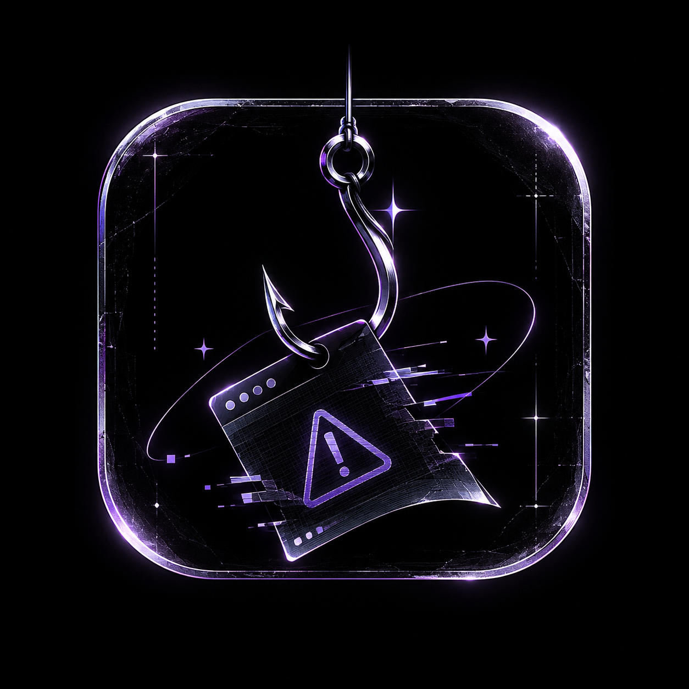

CatchPhish

Detect phishing. Stay protected.

CatchPhish is a security-first phishing and scam analysis platform that helps people understand suspicious links, messages, screenshots, and QR codes before they interact with them.

  <a href="https://catchphish-front.onrender.com/"><strong>Visit CatchPhish</strong></a>
  &nbsp; · &nbsp;
  <a href="https://github.com/Pavn31/CatchPhish">View Source Code</a>

  

Think before you click. Paste suspicious content, upload a screenshot, or scan a QR image to get a clear risk assessment and practical safety guidance.

Features

Capability	Description
URL Intelligence	Inspects redirects, punycode, encoded paths, risky TLDs, shorteners, downloads, and suspicious URL patterns.
Message Analysis	Detects phishing, WhatsApp scams, SMS fraud, phone pressure, brand impersonation, and multilingual scam signals.
Screenshot Analysis	Uses OCR to extract suspicious text from uploaded screenshots without storing the image.
QR Analysis	Decodes QR destinations and checks for payment, login, and scam-related warning signs.
Web Attack Detection	Flags common SQL injection and cross-site scripting payloads.
Risk Scoring	Converts detected signals into an easy-to-understand severity score and explanation.
Actionable Guidance	Explains what was detected, the potential impact, and what to do next.
Private Workspace	Supports authenticated sessions and scan history persistence when configured.

How It Works

Paste content or upload an image
            ↓
   CatchPhish extracts signals
            ↓
  Rules + URL intelligence scan
            ↓
 Risk score, indicators, and guidance

Images are processed in memory for analysis and are not stored by the image-analysis endpoint.

Tech Stack

* Frontend: HTML, CSS, Vanilla JavaScript
* Backend: Python, FastAPI
* Image Processing: Pillow, OpenCV, Tesseract OCR
* Authentication: FastAPI sessions with protected password handling
* Persistence: SQLite with optional Supabase integration
* Threat Intelligence: URLScan.io integration
* Deployment: Render

Run Locally

1. Clone the Repository

git clone https://github.com/Pavn31/CatchPhish.git
cd CatchPhish

2. Install Backend Dependencies

python -m venv .venv
source .venv/bin/activate       # Windows: .venv\Scripts\activate
pip install -r backend/requirements.txt

3. Start the API

uvicorn backend.main:app --reload --port 8000

4. Serve the Frontend

In a second terminal:

python3 -m http.server 5500 --directory frontend

Open http://127.0.0.1:5500 in your browser.

For optional integrations, configure the required values in backend/.env. Never commit API keys, session secrets, or other credentials.

API Endpoints

Method	Endpoint	Purpose
POST	/api/analyze	Analyze a URL, message, email, or payload.
POST	/api/analyze/image	Analyze a screenshot or QR image.
GET	/api/health	Check API availability.
GET	/api/urlscan/{scan_id}	Retrieve a URLScan result.

Run Tests

python -m pytest -q backend/test_security_features.py

Live Deployment

Service	URL
Live Website	https://catchphish-front.onrender.com/
Frontend	https://catchphish-front.onrender.com/
Backend API	https://catchphish-bxab.onrender.com/

Project Team

<table>
  <tr>
    <td align="center">
      <a href="https://github.com/Pavn31">
         
        <strong>Pavn31</strong>
      </a>
    </td>
    <td align="center">
      <a href="https://github.com/Seema-patil24">
         
        <strong>Seema-patil24</strong>
      </a>
    </td>
    <td align="center">
      <a href="https://github.com/Shetty22">
         
        <strong>Shetty22</strong>
      </a>
    </td>
    <td align="center">
      <a href="https://github.com/skk-07">
         
        <strong>skk-07</strong>
      </a>
    </td>
  </tr>
</table>

Contributing

Ideas, bug reports, and improvements are welcome. Open an issue or submit a pull request with a clear description of the change.

⸻

  <strong>Built with care by the CatchPhish team.</strong> 
  Stay alert. Verify first. Click second.

